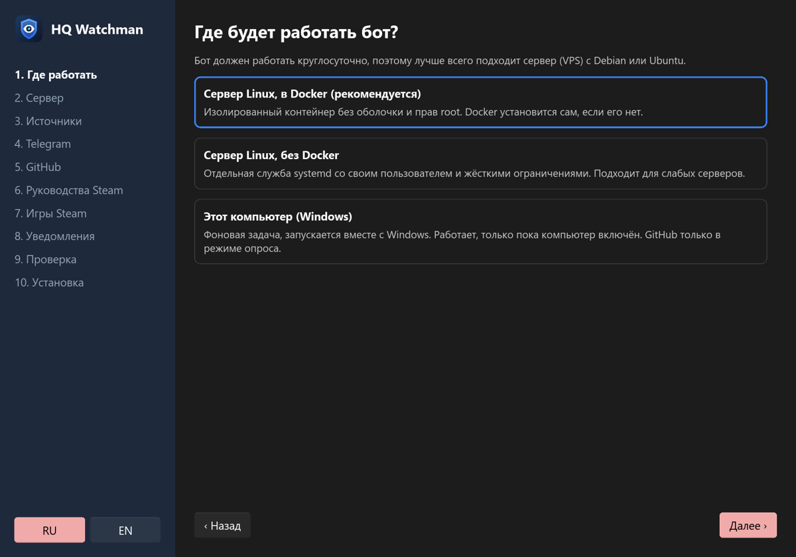
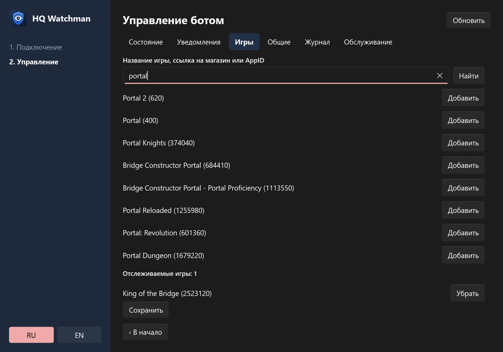
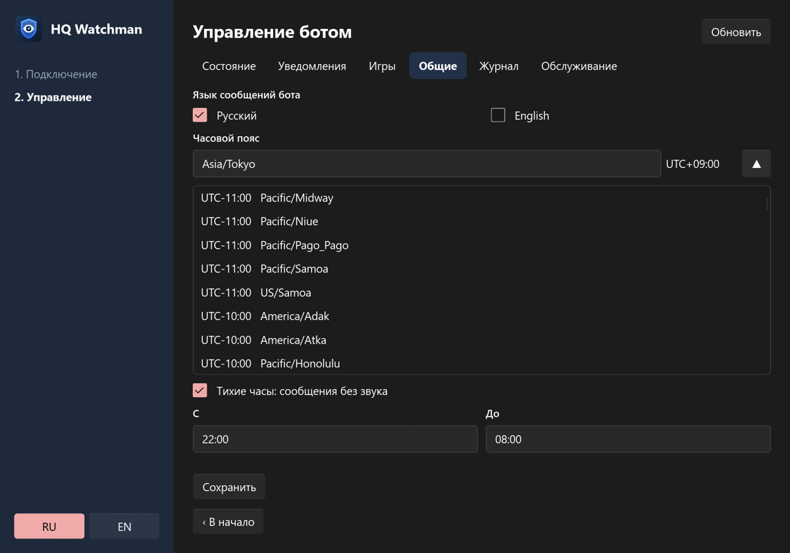

<div align="center">

# HQ Watchman

**Telegram bot that tells its owner about GitHub, Steam guide and Steam game events**
<br>
**Telegram-бот, который сообщает владельцу о событиях GitHub, руководств и игр Steam**

[](https://github.com/Mahiron-hq/hq-watchman/actions/workflows/ci.yml)
[](LICENSE)
[](#install)
[](https://www.rust-lang.org/)

### [Releases](https://github.com/Mahiron-hq/hq-watchman/releases)

**[English](#english)** | **[Русский](#русский)**

</div>

---

| | |
|---|---|
| Platform | Bot: Linux x86_64/arm64 (Docker or systemd), Windows x64. Setup app: Windows, macOS, Linux |
| Version | 0.1.2 |
| License | GPL-3.0-or-later |
| Languages | Bot messages in Russian, docs in English and Russian |

## English

HQ Watchman is a self-hosted Telegram bot for one person. It sends the owner private messages about activity in their GitHub repositories, comments under their Steam guides and updates of chosen Steam games. Nobody else can control it or learn anything about it.

### Contents

1. [Features](#features)
2. [Install without a console](#install-without-a-console)
3. [Install](#install)
4. [Usage](#usage)
5. [Build from source](#build-from-source)
6. [Security](#security)
7. [Changelog](#changelog)

### Features

- **GitHub** through a read-only GitHub App on all repositories, including private and future ones: new issues, pull requests and discussions, comments (new, edited, deleted), reviews, line comments, commit comments, new repositories. Your own actions and bots are filtered out. Missed webhooks are redelivered from the GitHub delivery log.
- **Steam guides** of one profile: new and deleted comments with the full text, new and removed guides. A deletion is reported only after two complete reads.
- **Steam games**: public build changes, beta branches, DLC (soundtracks excluded), news and patch notes from the developer feed. A build and its patch note arrive as one thread.
- **Delivery**: queue in SQLite, nothing is lost on restart, no duplicates. Long texts come as a Markdown file, bursts as one digest. Quiet hours with silent messages, pause with automatic resume.
- **Safety**: authorization by numeric Telegram ID, HMAC check before parsing, strict limits on every input, external text escaped and stripped of control and bidi characters, TLS via rustls only, no `unsafe`, non-root read-only container without a shell.
- **Any combination of sources**: only GitHub, only games, games and guides, or all three. Only the credentials of the chosen sources are needed.
- **Settings in Telegram**: `/settings` with buttons for sources, event types, repositories, games (add by name, link or AppID), quiet hours, time zone and language. Per game: updates, beta branches, DLC, news, patch notes.
- **Groups and channels**: add the bot to a group or channel and choose which sources go there.
- **GitHub without a domain**: polling mode reads events from the GitHub App delivery log, no open port needed.
- **Russian or English** bot messages.
- **Self-monitoring**: one message when a source fails and one when it recovers.

### Install without a console

**HQ Watchman Setup** is a desktop app for Windows, macOS and Linux that installs the bot on your server (Docker or systemd) or on this Windows computer, step by step:

1. Choose where the bot runs and enter the server address and password (passwords are never saved).
2. Choose the sources: GitHub, Steam guides, Steam games.
3. Paste the Telegram bot token, press Open the bot and then Start in Telegram: the bot gets a one-time code and the app learns your ID.
4. For GitHub, press two buttons in the browser: the read-only GitHub App is created and installed automatically.
5. Add games by name, pick language, time zone and quiet hours.
6. Press **Install**: the app checks the signature of the release files, sets everything up and checks that the bot works.

<p align="center">
  
  
</p>

Later the same app changes settings, shows logs, updates the bot with automatic rollback, backs up and restores the database and removes the bot. Download it from [Releases](https://github.com/Mahiron-hq/hq-watchman/releases); details in [docs/install.en.md](docs/install.en.md).

### Install

Manual installation on a Linux server with Docker: [docs/install.en.md](docs/install.en.md#3-manual-installation). In short:

1. Create a Telegram bot; for GitHub a private read-only GitHub App; for guides your SteamID64.
2. Load the image for your CPU from a release and check `SHA256SUMS.txt` and its minisign signature ([`minisign.pub`](minisign.pub)).
3. Copy [`deploy/compose.yaml`](deploy/compose.yaml) and [`deploy/config.example.toml`](deploy/config.example.toml), fill `.env` with the variables from [`deploy/.env.example`](deploy/.env.example).
4. `docker compose up -d`.

### Usage

| Command | What it does |
|---|---|
| `/settings` | Settings with buttons |
| `/help` | List of commands |
| `/status` | Version, uptime, state of every source, pause, queue size, quiet hours |
| `/sources` | Watched repositories, guides, games with branches and DLC |
| `/pause [2h]` | Pause notifications, forever or for a time (`30m`, `2h`, `1d`, `1w`) |
| `/resume` | Resume; collected events arrive, as a digest if there are many |
| `/check_now [github\|guides\|games]` | Check now, at most once a minute per source; the result arrives as a message |
| `/reload` | Re-read the config file without a restart |
| `/strangers` | Who else tried to write to the bot in the last 7 days |

Repositories and guides are picked up automatically. Games, event types and delivery are changed in `/settings`.

### Build from source

Requires Rust 1.99 (pinned in `rust-toolchain.toml`).

```sh
cargo build --release --locked
cargo test --locked
docker build -t hq-watchman:0.1.2 .
cd setup && cargo build --release --locked
```

Queries are checked at compile time against the `.sqlx` data in the repository, so no database is needed to build. On Linux the setup app needs the fontconfig, xkbcommon and Wayland/X11 development packages. Design notes: [docs/design.md](docs/design.md).

### Security

Report vulnerabilities privately, see [SECURITY.md](SECURITY.md).

### Changelog

See [CHANGELOG.md](CHANGELOG.md).

## Русский

HQ Watchman – Telegram-бот для одного человека, который работает на своём сервере. Он пишет владельцу в личные сообщения о событиях в его репозиториях GitHub, о комментариях под его руководствами Steam и об обновлениях выбранных игр Steam. Никто другой не может им управлять или что-то о нём узнать.

### Содержание

1. [Возможности](#возможности)
2. [Установка без консоли](#установка-без-консоли)
3. [Установка](#установка)
4. [Использование](#использование)
5. [Сборка из исходников](#сборка-из-исходников)
6. [Безопасность](#безопасность)
7. [Изменения](#изменения)

### Возможности

- **GitHub** через GitHub App только на чтение на всех репозиториях, включая приватные и будущие: новые Issue, Pull Request и обсуждения, комментарии (новые, изменённые, удалённые), ревью, комментарии к коду, комментарии к коммитам, новые репозитории. Ваши собственные действия и боты отфильтрованы. Пропущенные вебхуки запрашиваются повторно из журнала доставок GitHub.
- **Руководства Steam** одного профиля: новые и удалённые комментарии с полным текстом, новые и пропавшие руководства. Об удалении бот сообщает только после двух полных чтений.
- **Игры Steam**: смена билда ветки public, бета-ветки, DLC (без саундтреков), новости и патчноуты из канала разработчика. Билд и его патчноут приходят одной веткой сообщений.
- **Доставка**: очередь в SQLite, при перезапуске ничего не теряется и не дублируется. Длинные тексты приходят файлом Markdown, всплески событий одним дайджестом. Тихие часы с беззвучными сообщениями, пауза с автоматическим снятием.
- **Безопасность**: авторизация по числовому ID Telegram, проверка HMAC до разбора, строгие лимиты на всех входах, внешний текст экранируется и очищается от управляющих символов и символов направления текста, TLS только через rustls, без `unsafe`, контейнер без root, без оболочки и с файловой системой только для чтения.
- **Любое сочетание источников**: только GitHub, только игры, игры и руководства или все три. Нужны ключи только выбранных источников.
- **Настройки в Telegram**: `/settings` с кнопками для источников, типов событий, репозиториев, игр (добавление по названию, ссылке или AppID), тихих часов, часового пояса и языка. Для каждой игры: обновления, бета-ветки, DLC, новости, патчноуты.
- **Группы и каналы**: добавьте бота в группу или канал и выберите, какие источники туда слать.
- **GitHub без домена**: режим опроса читает события из журнала доставок GitHub App, открытый порт не нужен.
- **Русский или английский** язык сообщений бота.
- **Самоконтроль**: одно сообщение при сбое источника и одно при восстановлении.

### Установка без консоли

**HQ Watchman Setup** это программа для Windows, macOS и Linux, которая шаг за шагом устанавливает бота на ваш сервер (Docker или systemd) или на этот компьютер с Windows:

1. Выберите, где работает бот, и введите адрес сервера и пароль (пароли не сохраняются).
2. Выберите источники: GitHub, руководства Steam, игры Steam.
3. Вставьте токен Telegram-бота, нажмите «Открыть бота», а затем Start в Telegram: бот получит одноразовый код, и программа узнает ваш ID.
4. Для GitHub нажмите две кнопки в браузере: GitHub App только на чтение создаётся и устанавливается само.
5. Добавьте игры по названию, выберите язык, часовой пояс и тихие часы.
6. Нажмите **Установить**: программа проверит подпись файлов релиза, всё настроит и проверит работу бота.

<p align="center">
  
  
</p>

Потом та же программа меняет настройки, показывает журнал, обновляет бота с автоматическим откатом, делает и восстанавливает резервную копию базы и удаляет бота. Скачать: [Releases](https://github.com/Mahiron-hq/hq-watchman/releases); подробности в [docs/install.ru.md](docs/install.ru.md).

### Установка

Установка вручную на сервер Linux с Docker: [docs/install.ru.md](docs/install.ru.md#3-установка-вручную). Коротко:

1. Создайте Telegram-бота; для GitHub приватное GitHub App только на чтение; для руководств ваш SteamID64.
2. Загрузите образ для своего процессора из релиза и проверьте `SHA256SUMS.txt` и его подпись minisign ([`minisign.pub`](minisign.pub)).
3. Скопируйте [`deploy/compose.yaml`](deploy/compose.yaml) и [`deploy/config.example.toml`](deploy/config.example.toml), заполните `.env` переменными из [`deploy/.env.example`](deploy/.env.example).
4. `docker compose up -d`.

### Использование

| Команда | Что делает |
|---|---|
| `/settings` | Настройки с кнопками |
| `/help` | Список команд |
| `/status` | Версия, время работы, состояние каждого источника, пауза, очередь, тихие часы |
| `/sources` | Отслеживаемые репозитории, руководства, игры с ветками и DLC |
| `/pause [2h]` | Пауза уведомлений, без срока или на время (`30m`, `2h`, `1d`, `1w`) |
| `/resume` | Снять паузу; накопленное придёт, дайджестом, если событий много |
| `/check_now [github\|guides\|games]` | Проверить сейчас, не чаще раза в минуту на источник; итог приходит сообщением |
| `/reload` | Перечитать конфиг без перезапуска |
| `/strangers` | Кто ещё пытался писать боту за 7 дней |

Репозитории и руководства подключаются сами. Игры, типы событий и доставка меняются в `/settings`.

### Сборка из исходников

Нужен Rust 1.99 (закреплён в `rust-toolchain.toml`).

```sh
cargo build --release --locked
cargo test --locked
docker build -t hq-watchman:0.1.2 .
cd setup && cargo build --release --locked
```

Запросы к базе проверяются при компиляции по данным `.sqlx` из репозитория, поэтому база для сборки не нужна. На Linux программе установки нужны пакеты разработки fontconfig, xkbcommon и Wayland/X11. Заметки об устройстве: [docs/design.md](docs/design.md).

### Безопасность

Об уязвимостях сообщайте закрыто, см. [SECURITY.md](SECURITY.md).

### Изменения

См. [CHANGELOG.md](CHANGELOG.md).

---

## License

GPL-3.0-or-later, see [LICENSE](LICENSE).

<div align="center">

Copyright © 2026 Lev Burmistrov (Mahiron-hq)
<br>
Mahiron.HQ@protonmail.com | t.me/mahiron_hq

</div>
